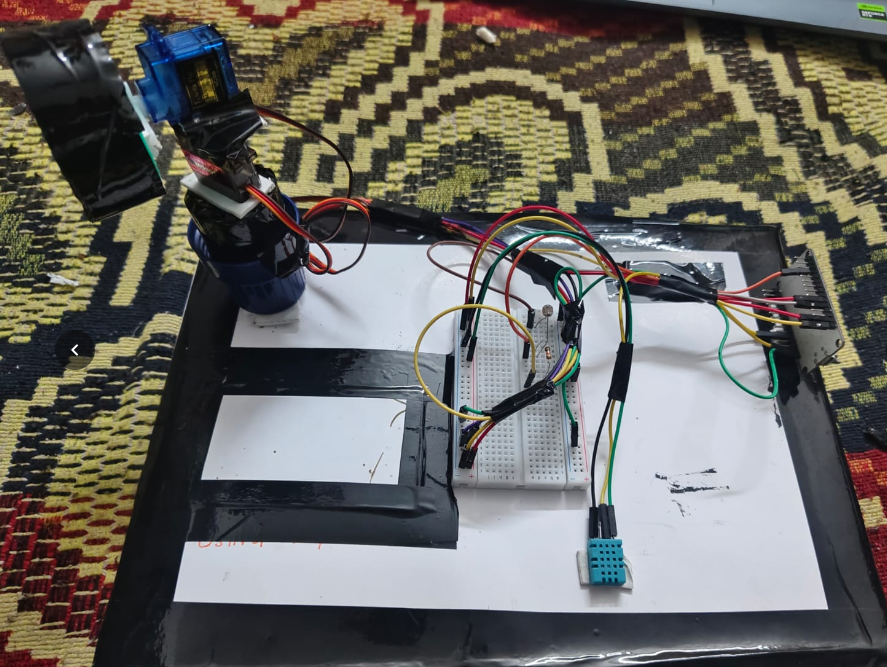
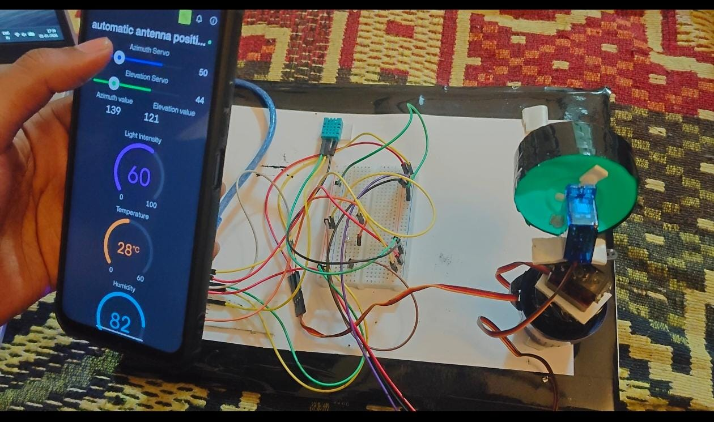

# Smart Antenna Position System

An IoT-based antenna positioning system. Two servo motors (azimuth and elevation) move the antenna, while an LDR and a DHT11 sensor monitor light intensity, temperature and humidity. Everything is controlled and monitored live from a mobile dashboard.

## Photos
| Hardware | Mobile dashboard |
|---|---|
|  |  |

## Features
- Two-axis antenna movement: azimuth (pan) and elevation (tilt)
- Manual control with sliders on the mobile app
- Automatic mode: scans the area and moves to the position with the strongest light/signal reading
- Live light intensity, temperature and humidity readings
- Live display of current azimuth and elevation angles

## Components
| Component | Quantity |
|---|---|
| ESP32 development board | 1 |
| SG90 micro servo | 2 |
| LDR with resistor (voltage divider) | 1 |
| DHT11 temperature & humidity sensor | 1 |
| Breadboard and jumper wires | - |
| Antenna / dish mount | 1 |
| USB cable / 5 V supply | 1 |

## Pin connections
| Part | ESP32 pin |
|---|---|
| Azimuth servo | GPIO 18 |
| Elevation servo | GPIO 19 |
| LDR (analog) | GPIO 34 |
| DHT11 data | GPIO 4 |

> Update this table to match your wiring.

## Dashboard (Blynk) datastreams
| Virtual pin | Widget |
|---|---|
| V0 | Azimuth slider (0-180) |
| V1 | Elevation slider (0-180) |
| V2 | Light intensity gauge (0-100) |
| V3 | Temperature gauge |
| V4 | Humidity gauge |
| V5 | Azimuth value |
| V6 | Elevation value |
| V7 | Auto mode switch |

## Setup
1. Install the [Arduino IDE](https://www.arduino.cc/en/software) and ESP32 board support.
2. Install these libraries from the Library Manager: **Blynk**, **ESP32Servo**, **DHT sensor library** (Adafruit).
3. Create a Blynk template with the datastreams above and copy its Template ID and Auth Token.
4. In `code/`, copy `secrets_example.h` to `secrets.h` and enter your Blynk and Wi-Fi details.
5. Open `code/smart_antenna.ino`, select your ESP32 board and port, and upload.

## How auto mode works
The servos sweep through a grid of azimuth and elevation angles. At each position the LDR reading is recorded, and the antenna finally moves to the position with the highest reading. The scan repeats every 30 seconds while auto mode is on.

## Future improvements
- Use multiple sensors or a real signal-strength (RSSI) reading
- Satellite or sun tracking using time and location
- Data logging and graphs

## Author
Your Name - [GitHub profile link]

## License
MIT License
